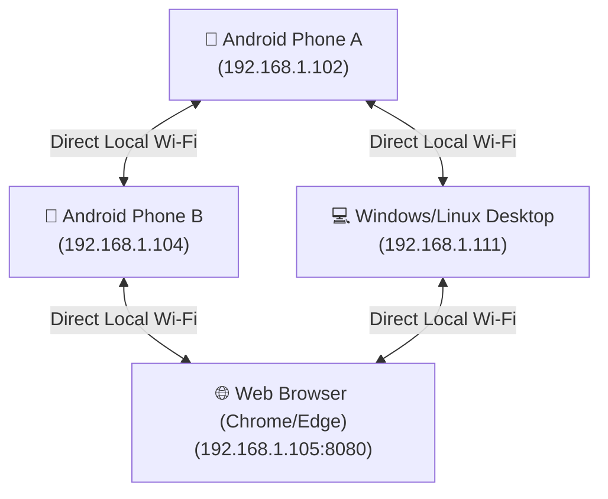
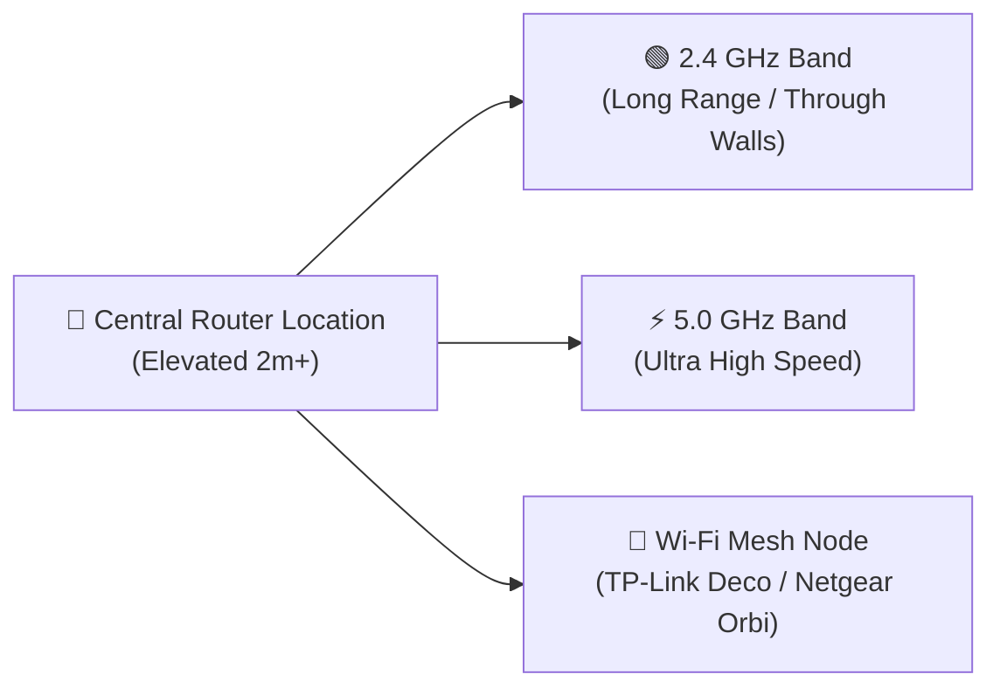

# 📶 WiFili Messenger (LanChat) • 100% Offline P2P LAN Chat & Calling App


**WiFili Messenger** (also known as **LanChat**) is a 100% offline, cross-platform, peer-to-peer (P2P) local area network (LAN) messaging, high-speed file sharing, and real-time audio/video calling application. It connects **Android smartphones, Windows PCs, Linux desktops, and Web Browsers** directly over local Wi-Fi routers or Mobile Hotspots without needing an internet connection, cloud databases, or third-party servers.

---

## 📥 Direct Downloads & Releases (Working Binaries)

| Platform | Direct Download Link | Description | File Format |
| :--- | :--- | :--- | :--- |
| **📱 Android App** | [📥 Download WiFili-Messenger-Android.apk](https://github.com/MohsinTahir4/WiFili-Messenger/raw/main/releases/WiFili-Messenger-Android.apk) | Ready-to-install Android APK | `.apk` (~12 MB) |
| **💻 Windows & Linux Desktop** | [📥 Download WiFili-Messenger-Desktop.jar](https://github.com/MohsinTahir4/WiFili-Messenger/raw/main/releases/WiFili-Messenger-Desktop.jar) | Standalone Executable Java JAR | `.jar` (~8 MB) |
| **🌐 Web Server Scripts** | [📥 Download run-web.bat](https://github.com/MohsinTahir4/WiFili-Messenger/raw/main/run-web.bat) / [run-web.sh](https://github.com/MohsinTahir4/WiFili-Messenger/raw/main/run-web.sh) | Web Server Launchers for Chrome/Edge | `.bat` / `.sh` |

---

## 📱 Application Overview, Screenshots & How-to-Use Guide

| Platform | Application Description | How to Use Step-by-Step | Interface & Design |
| :--- | :--- | :--- | :--- |
| **📱 Android App** | **Full-Featured Offline LAN Messenger**<br>• Real-time text & emoji chat.<br>• Ultra-low latency voice & video calling.<br>• High-speed file sharing with progress bars (`0%-100%`).<br>• In-app video player. | **1.** Connect to local Wi-Fi or turn on Mobile Hotspot.<br>**2.** Tap `⚡ Scan LAN Users` to discover nearby devices.<br>**3.** Tap any online user on the list to start chatting, file sharing, or making audio/video calls! | **Android UI Design**<br>Clean WhatsApp-style UI with top action bar (`📞 Audio`, `🎥 Video`), message timeline, and bottom input field with attachment picker. |
| **💻 Desktop App (Windows & Linux)** | **Native Java Swing GUI App**<br>• Dark slate theme matching Web Edition.<br>• Real-time peer discovery sidebar.<br>• Standalone executable JAR (`.jar`). | **1.** Connect your PC/laptop to the same Wi-Fi.<br>**2.** Double-click `run-desktop.bat` (Windows) or `./run-desktop.sh` (Linux).<br>**3.** Click `⚡ Scan LAN Users`, select a user on the left, and chat or call! | **Desktop UI Design**<br>Modern dark slate dual-pane interface with left search/peer list and right active chat & video call modal window. |
| **🌐 Web Browser Edition** | **Zero-Install Web App**<br>• Runs locally in Chrome, Edge, Firefox, or Safari.<br>• Powered by embedded HTTP server (`:8080`).<br>• Dark/Light theme toggle. | **1.** Connect your phone/PC to local Wi-Fi.<br>**2.** Double-click `run-web.bat` (Windows) or `./run-web.sh` (Linux).<br>**3.** Open `http://localhost:8080` in Chrome/Edge to start messaging! | **Web UI Design**<br>Responsive HTML5 dashboard with dark/light mode toggle, live peer polling, and full P2P messaging. |

---

## 🌐 Offline Mesh Architecture



---

## ✨ Feature Summary

| Feature | Description |
| :--- | :--- |
| **💬 Direct Messaging & Emojis** | Real-time chat with custom emoji selection. |
| **📄 High-Speed File Transfer** | Share photos, videos, audio notes, and documents (PDF, DOCX, ZIP) with percentage progress bars (`0% - 100%`). |
| **📞 Audio Calling** | Low-latency 16kHz PCM audio calls over UDP with Loudspeaker & Earpiece toggle. |
| **🎥 Video Calling** | Upright portrait video calling with front/back camera switching and local picture-in-picture preview. |
| **💻 Desktop App (Windows & Linux)** | Native Java Swing GUI app (`:desktop` module) matching the web design. |
| **🌐 Web Browser Edition** | HTML5 Web App ([web/index.html](web/index.html)) powered by an embedded HTTP Web Server. |
| **🔧 Connection Diagnostics** | Active IP status detection, network discovery scan, and step-by-step troubleshooting guides. |

---

## 🏗️ Technical Architecture & Network Ports

| Protocol | Port | Purpose |
| :--- | :--- | :--- |
| **UDP Broadcast** | `45454` | LAN Subnet Peer Discovery (`LANCHAT\|id\|name`) |
| **TCP Sockets** | `45455` | Text Messages & File Transfer Streams |
| **UDP Stream** | `45457` | Non-blocking 16kHz PCM Audio Calling |
| **UDP Stream** | `45458` | YUV JPEG Video Frame Calling |
| **HTTP Server** | `8080` | Embedded Web Server for Chrome/Edge access |

---

## 📶 How to Increase Wi-Fi Range with a Good Router

To get maximum range and coverage for WiFili Messenger across large homes, offices, or outdoor areas:



1. **Optimal Router Placement**: Place your Wi-Fi router in a central, elevated position (at least 1.5–2 meters high) away from thick concrete walls and metal objects.
2. **Wi-Fi Band Selection**: Use **2.4 GHz** for long range through walls, and **5.0 GHz** for ultra-fast video calling and large file transfers.
3. **Mesh Systems**: Use Mesh Wi-Fi routers (TP-Link Deco, Netgear Orbi, or ASUS Mesh) for seamless multi-story coverage.
4. **Mobile Hotspot**: Turn on Mobile Hotspot on one phone when outdoors; all other phones and laptops connect directly.

---

## 🚀 How to Build & Run

### 1. Android App
Build and install via Android Studio or Terminal:
```bash
./gradlew :app:assembleDebug
```

### 2. Desktop App (Windows & Linux)
- **Windows**: Double-click `run-desktop.bat` or run:
  ```cmd
  run-desktop.bat
  ```
- **Linux**:
  ```bash
  chmod +x run-desktop.sh
  ./run-desktop.sh
  ```

### 3. Web App Edition (Chrome / Edge / Firefox)
- **Windows**: Double-click `run-web.bat` or run:
  ```cmd
  run-web.bat
  ```
- **Linux**:
  ```bash
  chmod +x run-web.sh
  ./run-web.sh
  ```
Open `http://localhost:8080` or `http://<your-ip>:8080` in Chrome/Edge!

---

## ☕ Support & Donations (Coinbase & Binance)

If you find **WiFili Messenger** helpful and want to support open-source offline development, you can donate via Coinbase, Binance, or Cryptocurrency!

[](https://www.coinbase.com)
[](https://www.binance.com)

- **Coinbase (ETH / USDC / BTC)**: `0xYourCoinbaseWalletAddressHere`
- **Binance (USDT / BNB / SOL)**: `YourBinanceDepositAddressHere`

---

## 📄 License
This project is released under the **MIT License**.
