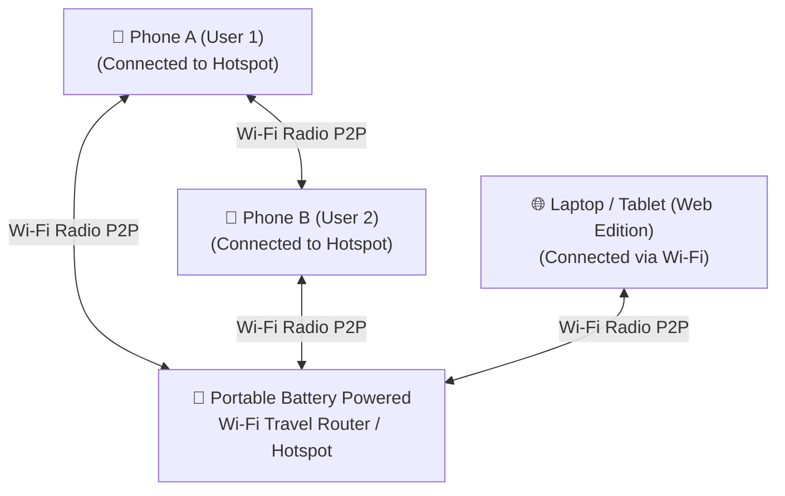

<!-- Layout Version: 19.0 - WiFili Messenger Android & Web Edition -->
# 📶 WiFili Messenger • 100% Offline P2P LAN Chat & File Sharing (Android & Web)

[](#-android-app-guide--source-and-binaries)
[](#-web-browser-edition-guide--source-and-binaries)
[](#-direct-downloads--releases)

**WiFili Messenger** is a 100% offline, peer-to-peer (P2P) local area network (LAN) messaging, high-speed file sharing, and audio/video calling application. It connects **Android smartphones, tablets, and Web Browsers** directly over local Wi-Fi routers or Mobile Hotspots without needing an internet connection, cloud databases, or cellular towers.

---

## 📥 Direct Downloads & Releases (Android APK & Web Edition)

| Edition / Platform | Direct Download Link | Description & Included Files | File Format | File Size |
| :--- | :--- | :--- | :--- | :--- |
| **🌟 Complete Suite** | [📥 Download Complete Package (.zip)](https://github.com/MohsinTahir4/WiFili-Messenger/raw/main/releases/WiFili-Messenger-Complete-Source-And-Binaries.zip) | **Complete Source & Binaries**: Contains Android APK, Web Server JAR (`WiFili-WebServer.jar`), HTML5 UI, and complete source code. | `.zip` | **~45.4 MB** |
| **📱 Android Smartphone** | [📥 Download Android App (.apk)](https://github.com/MohsinTahir4/WiFili-Messenger/raw/main/releases/WiFili-Messenger-Android.apk) | **Android Binary**: Ready-to-install APK for all Android smartphones and tablets. | `.apk` | ~6.0 MB |
| **🌐 Web Browser Edition** | [📥 Download Web Edition Complete (.zip)](https://github.com/MohsinTahir4/WiFili-Messenger/raw/main/releases/WiFili-Messenger-Web-Complete.zip) | **Web Source & Binaries Complete**: Contains HTTP Web Server binary (`WiFili-WebServer.jar`), HTML5 UI (`web/index.html`), and full source files. | `.zip` | ~49 KB |

---

## 🏕️ How to Set Up WiFili Messenger Where Internet is Not Available (Jungle, Desert, Mountains, Disasters)

Because WiFili Messenger uses **local Wi-Fi radio waves** rather than internet infrastructure, you can set up a fully functioning communication network anywhere on Earth:



### Setup Instructions for Off-Grid Environments:
1. **Primary Hotspot Phone / Portable Router**:
   - Take any Android smartphone or a battery-powered portable Wi-Fi travel router (e.g., GL.iNet, TP-Link MR3040).
   - Turn on **Mobile Hotspot** (or turn on the travel router). *Note: You do NOT need cellular data or a SIM card with internet; just the Wi-Fi hotspot feature.*
2. **Connect All Devices**:
   - Connect all other smartphones, tablets, and laptops to that same Wi-Fi Hotspot / Router network.
3. **Launch WiFili Messenger**:
   - Open the Android app or open `http://<router-ip>:8080` in any web browser.
   - Instantly chat, send high-speed files (photos, videos, documents), make audio calls, and video call locally with zero internet!

---

## 📡 How to Extend Wi-Fi Range up to 5km or More (Long-Range Outdoor CPE Setup)

Standard mobile hotspots or home routers have a range of about 15–30 meters. To extend your Wi-Fi range up to **5km, 10km, or even farther** across remote valleys, deserts, or camps, use **Long-Range Outdoor CPE Wireless Bridges (Point-to-Point / PTP)**:

```mermaid
graph LR
    Base["🏕️ Base Camp / Main Phone<br>+ Wi-Fi Hotspot / Router"] -->|Ethernet Cable| CPE1["📡 Outdoor CPE Router A<br>(Ubiquiti / TP-Link CPE510)"]
    CPE1 ==>|Directional 5GHz Wi-Fi Beam<br>(Up to 5km - 15km LOS Line of Sight)| CPE2["📡 Outdoor CPE Router B<br>(Remote Camp Receiver)"]
    CPE2 -->|Ethernet Cable| AP["📶 Remote Wi-Fi Access Point<br>+ Switch / Extender"]
    AP --> RemoteUsers["📱 Remote Phones & Laptops<br>(Connected to Wi-Fi)"]
```

### Hardware Equipment Needed:
- **2x Outdoor CPE Units** (e.g., *Ubiquiti NanoStation Loco M5*, *TP-Link CPE510*, or *TP-Link CPE210*). These cost around $40–$60 each and operate on 24V Power-over-Ethernet (PoE).
- **Portable Battery Pack / Solar Generator** (for off-grid power).
- **Ethernet Cables**.

### Step-by-Step 5km+ Range Extension Guide:
1. **At Base Camp (Transmitter)**:
   - Connect your Wi-Fi router or hotspot to **Outdoor CPE Unit A** via an Ethernet cable.
   - Mount CPE Unit A on a pole or mast pointing directly toward the remote location.
2. **At Remote Camp (Receiver)**:
   - Mount **Outdoor CPE Unit B** pointing back toward Base Camp (requires clear **Line of Sight / LOS** with no major blocking mountains or thick obstructions).
   - Connect CPE Unit B via Ethernet to a local Wi-Fi Access Point or travel router.
3. **Result**:
   - The two CPE units form an invisible wireless bridge over the air. Any device connecting to the remote Wi-Fi access point is instantly bridged directly into your local Wi-Fi network, allowing users **5km+ away** to open WiFili Messenger and communicate in real-time!

---

## 🌐 Web Browser Edition Guide (Source & Binary Complete)

### 📦 Binaries
- The Web Edition includes the pre-compiled **Web Server Binary** (`WiFili-WebServer.jar`) and the modern HTML5 web client ([index.html](desktop/src/main/java/com/example/lanchat/desktop/resources/web/index.html)).
- **How to Use Binary**:
  1. Download `WiFili-WebServer.jar` (or the complete package).
  2. Run the server binary:
     ```bash
     java -jar WiFili-WebServer.jar
     ```
  3. Open your browser and navigate to **`http://localhost:8080`** (or your PC's local Wi-Fi IP address `http://192.168.x.x:8080`).

### 🛠️ Source Code
- **Full Web Server Source**: [`desktop/src/main/java/com/example/lanchat/desktop/WebServer.java`](desktop/src/main/java/com/example/lanchat/desktop/WebServer.java)
- **Web UI HTML5 Source**: [`desktop/src/main/java/com/example/lanchat/desktop/resources/web/index.html`](desktop/src/main/java/com/example/lanchat/desktop/resources/web/index.html)

---

## 📱 Android App Guide (Source & Binary Complete)

### 📦 Binary (`.apk`)
- Download [`WiFili-Messenger-Android.apk`](https://github.com/MohsinTahir4/WiFili-Messenger/raw/main/releases/WiFili-Messenger-Android.apk) and install directly on Android devices.

### 🛠️ Source Code
- **Source Location**: [`app/src/main/java/com/example/lanchat/`](app/src/main/java/com/example/lanchat/)
- **Build APK via Gradle**:
  ```bash
  ./gradlew :app:assembleDebug
  ```

---

## 🏗️ Technical Architecture & Network Ports

| Protocol | Port | Purpose |
| :--- | :--- | :--- |
| **UDP Broadcast** | `45454` | LAN Subnet Peer Discovery (`LANCHAT\|id\|name`) |
| **TCP Sockets** | `45455` | Text Messages & File Transfer Streams |
| **UDP Stream** | `45457` | Non-blocking 16kHz PCM Audio Calling |
| **UDP Stream** | `45458` | YUV JPEG Video Frame Calling |
| **HTTP Server** | `8080` | Embedded Web Server for Browser access |

---

## ☕ Support & Donations (Coinbase & Binance)

If you find **WiFili Messenger** helpful for off-grid or local communications, you can donate via Coinbase or Binance!

[](https://www.coinbase.com)
[](https://www.binance.com)

- **Coinbase (ETH / USDC / BTC)**: `0xYourCoinbaseWalletAddressHere`
- **Binance (USDT / BNB / SOL)**: `YourBinanceDepositAddressHere`

---

## 📄 License
This project is released under the **MIT License**.
