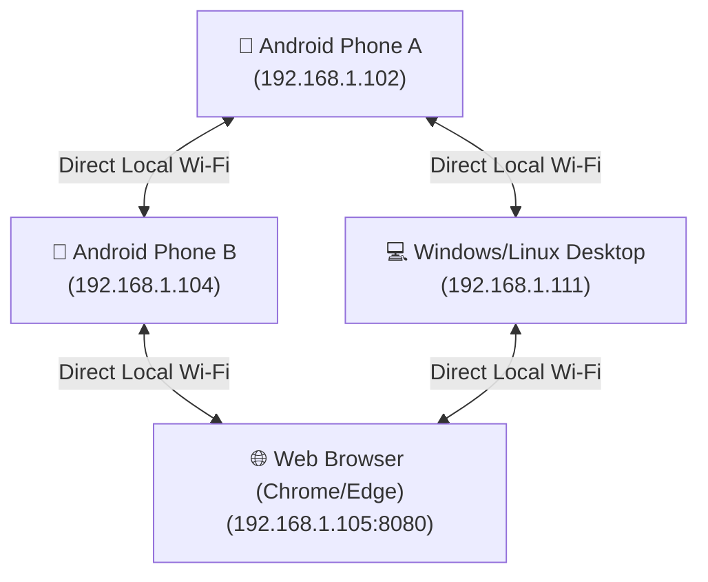
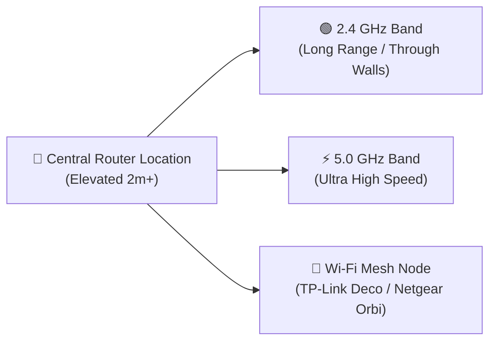

# 📶 WiFili Messenger (LanChat) • 100% Offline P2P LAN Chat & Calling App

[](#-android-app-guide)
[](#-windows--linux-desktop-app-guide)
[](#-windows--linux-desktop-app-guide)
[](#-web-browser-edition-guide)
[](#-direct-downloads--releases)

**WiFili Messenger** (also known as **LanChat**) is a 100% offline, cross-platform, peer-to-peer (P2P) local area network (LAN) messaging, high-speed file sharing, and real-time audio/video calling application. It connects **Android smartphones, Windows PCs, Linux desktops, and Web Browsers** directly over local Wi-Fi routers or Mobile Hotspots without needing an internet connection, cloud databases, or third-party servers.

---

## 📥 Direct Downloads & Releases (Complete Packages)

| Device / Platform | Direct Download Link | Description & Included Files | File Format | File Size |
| :--- | :--- | :--- | :--- | :--- |
| **📱 Android Smartphone** | [📥 Download WiFili-Messenger-Android.apk](https://github.com/MohsinTahir4/WiFili-Messenger/raw/main/releases/WiFili-Messenger-Android.apk) | **Android App**: Ready-to-install APK for all Android smartphones. | `.apk` | ~6.0 MB |
| **💻 PC, Laptop, Windows, Linux & Web** | [📥 Download WiFili-Messenger-Complete-Package.zip](https://github.com/MohsinTahir4/WiFili-Messenger/raw/main/releases/WiFili-Messenger-Complete-Package.zip) | **Master All-in-One PC Package**: Contains Desktop App, Web Edition, 1-Click Launchers, and **README-Instructions.txt**! | `.zip` | ~49 KB |

---

### 📖 Simple Guide: How to Download & Use

#### 💻 For PC & Laptop Users (`WiFili-Messenger-Complete-Package.zip`):
1. Click **`[📥 Download WiFili-Messenger-Complete-Package.zip]`** above.
2. Extract the downloaded ZIP folder on your computer.
3. Open the folder and read **`README-Instructions.txt`** for step-by-step instructions.
4. **To open Desktop App**: Double-click **`1-Click-Start-Desktop-App.bat`**.
5. **To open Web Edition in Chrome/Edge**: Double-click **`1-Click-Start-Web-Browser-App.bat`**.

#### 📱 For Android Smartphone Users (`.apk`):
1. Click **`[📥 Download WiFili-Messenger-Android.apk]`** on your phone.
2. Open the downloaded `.apk` file and tap **Install**.
3. Launch **WiFili Messenger** and tap **`⚡ Scan LAN Users`** to start chatting!

---

## 📱 Android App Guide

### Overview & Interface Design
The **WiFili Android App** features a modern WhatsApp/Telegram-style user interface built for high-speed offline local Wi-Fi communication.

| Feature | Description |
| :--- | :--- |
| **💬 Offline Chat** | Instant peer-to-peer messaging with built-in emoji selection. |
| **📄 File Sharing** | Send photos, videos, audio notes, and documents (PDF, DOCX, ZIP) with **live percentage progress bars (`0%-100%`)**. |
| **📞 Audio Calling** | Low-latency 16kHz PCM audio calls over UDP with Loudspeaker & Earpiece toggle. |
| **🎥 Video Calling** | Upright portrait video calling with front/back camera switching and local picture-in-picture preview. |
| **🎬 Video Player** | In-app video player to preview received videos directly. |

---

## 💻 Windows & Linux Desktop App Guide

### Overview & Interface Design
The **WiFili Desktop App** is a native Java Swing application (`:desktop` module) styled in a sleek dark slate theme that matches the web browser edition.

| Feature | Description |
| :--- | :--- |
| **🔍 Search & Discovery** | Real-time LAN user search sidebar displaying online status badges (`🟢 Online`). |
| **💬 PC Messaging** | Full desktop keyboard chat with custom emoji picker and file attachment dialogs. |
| **📞 Desktop Calls** | Complete audio & video call modal windows with live video preview, mute microphone, and hangup buttons. |

---

## 🌐 Web Browser Edition Guide

### Overview & Interface Design
The **WiFili Web Edition** runs locally in **Chrome, Edge, Firefox, or Safari** via an embedded HTTP Web Server running on port `8080`.

| Feature | Description |
| :--- | :--- |
| **⚡ Zero Installation** | Runs instantly inside any web browser without installing additional software. |
| **🎨 Dark & Light Theme** | Toggle between dark and light modes effortlessly. |
| **🔄 Live Peer Polling** | Automatically polls `/api/peers` every 2 seconds to list online Wi-Fi users. |

---

## 🌐 Offline Mesh Architecture



---

## ✨ Feature Summary

| Feature | Description |
| :--- | :--- |
| **💬 Direct Messaging & Emojis** | Real-time chat with custom emoji selection. |
| **📄 High-Speed File Transfer** | Share photos, videos, audio notes, and documents (PDF, DOCX, ZIP) with percentage progress bars (`0% - 100%`). |
| **📞 Audio Calling** | Low-latency 16kHz PCM audio calls over UDP with Loudspeaker & Earpiece toggle. |
| **🎥 Video Calling** | Upright portrait video calling with front/back camera switching and local picture-in-picture preview. |
| **💻 Desktop App (Windows & Linux)** | Native Java Swing GUI app (`:desktop` module) matching the web design. |
| **🌐 Web Browser Edition** | HTML5 Web App ([web/index.html](web/index.html)) powered by an embedded HTTP Web Server. |
| **🔧 Connection Diagnostics** | Active IP status detection, network discovery scan, and step-by-step troubleshooting guides. |

---

## 🏗️ Technical Architecture & Network Ports

| Protocol | Port | Purpose |
| :--- | :--- | :--- |
| **UDP Broadcast** | `45454` | LAN Subnet Peer Discovery (`LANCHAT\|id\|name`) |
| **TCP Sockets** | `45455` | Text Messages & File Transfer Streams |
| **UDP Stream** | `45457` | Non-blocking 16kHz PCM Audio Calling |
| **UDP Stream** | `45458` | YUV JPEG Video Frame Calling |
| **HTTP Server** | `8080` | Embedded Web Server for Chrome/Edge access |

---

## 📶 How to Increase Wi-Fi Range with a Good Router

To get maximum range and coverage for WiFili Messenger across large homes, offices, or outdoor areas:



1. **Optimal Router Placement**: Place your Wi-Fi router in a central, elevated position (at least 1.5–2 meters high) away from thick concrete walls and metal objects.
2. **Wi-Fi Band Selection**: Use **2.4 GHz** for long range through walls, and **5.0 GHz** for ultra-fast video calling and large file transfers.
3. **Mesh Systems**: Use Mesh Wi-Fi routers (TP-Link Deco, Netgear Orbi, or ASUS Mesh) for seamless multi-story coverage.
4. **Mobile Hotspot**: Turn on Mobile Hotspot on one phone when outdoors; all other phones and laptops connect directly.

---

## 🚀 How to Build & Run

### 1. Android App
Build and install via Android Studio or Terminal:
```bash
./gradlew :app:assembleDebug
```

### 2. Desktop App (Windows & Linux)
- **Windows**: Double-click `run-desktop.bat` or run:
  ```cmd
  run-desktop.bat
  ```
- **Linux**:
  ```bash
  chmod +x run-desktop.sh
  ./run-desktop.sh
  ```

### 3. Web App Edition (Chrome / Edge / Firefox)
- **Windows**: Double-click `run-web.bat` or run:
  ```cmd
  run-web.bat
  ```
- **Linux**:
  ```bash
  chmod +x run-web.sh
  ./run-web.sh
  ```
Open `http://localhost:8080` or `http://<your-ip>:8080` in Chrome/Edge!

---

## ☕ Support & Donations (Coinbase & Binance)

If you find **WiFili Messenger** helpful and want to support open-source offline development, you can donate via Coinbase, Binance, or Cryptocurrency!

[](https://www.coinbase.com)
[](https://www.binance.com)

- **Coinbase (ETH / USDC / BTC)**: `0xYourCoinbaseWalletAddressHere`
- **Binance (USDT / BNB / SOL)**: `YourBinanceDepositAddressHere`

---

## 📄 License
This project is released under the **MIT License**.
