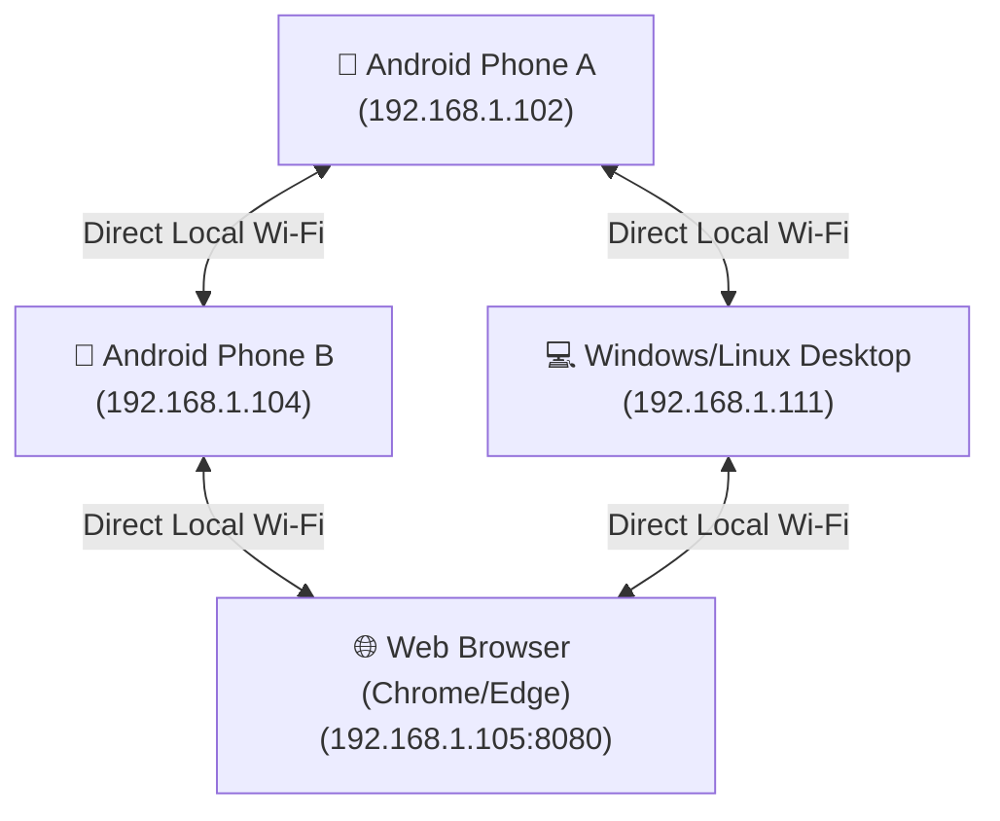

<!-- Layout Version: 17.0 - WiFili Messenger Master Complete -->
# 📶 WiFili Messenger • 100% Offline P2P LAN Chat, Calling & File Sharing Suite

[](#-android-app-guide--source-and-binaries)
[](#-windows--linux-desktop-app-guide--source-and-binaries)
[](#-web-browser-edition-guide--source-and-binaries)
[](#-direct-downloads--releases)

**WiFili Messenger** is a 100% offline, cross-platform, peer-to-peer (P2P) local area network (LAN) messaging, high-speed file sharing, and real-time audio/video calling application. It connects **Android smartphones, Windows PCs, Linux desktops, and Web Browsers** directly over local Wi-Fi routers or Mobile Hotspots without needing an internet connection, cloud databases, or third-party servers.

---

## 📥 Direct Downloads & Releases (Complete Source & Binaries)

| Edition / Platform | Direct Download Link | Description & Included Files | File Format | File Size |
| :--- | :--- | :--- | :--- | :--- |
| **🌟 Complete Suite** | [📥 Download Complete Package (.zip)](https://github.com/MohsinTahir4/WiFili-Messenger/raw/main/releases/WiFili-Messenger-Complete-Source-And-Binaries.zip) | **Complete Source & Binaries**: Contains all Android APK, Desktop JAR, Web Server, source code repository, and documentation. | `.zip` | **~45.4 MB** |
| **📱 Android Smartphone** | [📥 Download Android App (.apk)](https://github.com/MohsinTahir4/WiFili-Messenger/raw/main/releases/WiFili-Messenger-Android.apk) | **Android Binary**: Ready-to-install APK for all Android smartphones. | `.apk` | ~6.0 MB |
| **💻 Desktop Edition** | [📥 Download Desktop Complete (.zip)](https://github.com/MohsinTahir4/WiFili-Messenger/raw/main/releases/WiFili-Messenger-Desktop-Complete.zip) | **Desktop Source & Binaries**: Contains Java Desktop JAR (`WiFili-Messenger-Desktop.jar`), source files, and shell scripts. | `.zip` | ~44 KB |
| **🌐 Web Browser Edition** | [📥 Download Web Edition (.zip)](https://github.com/MohsinTahir4/WiFili-Messenger/raw/main/releases/WiFili-Messenger-Web-Complete.zip) | **Web Source & Binaries**: Contains HTTP Web Server, HTML5 UI (`web/index.html`), and source files. | `.zip` | ~49 KB |

---

## 📖 User Instructions (No Batch Files Required)

### 📱 1. Android Smartphone App
1. Download [WiFili-Messenger-Android.apk](https://github.com/MohsinTahir4/WiFili-Messenger/raw/main/releases/WiFili-Messenger-Android.apk) on your phone.
2. Tap the APK file, allow installation from unknown sources, and tap **Install**.
3. Open **WiFili Messenger**, enter your display name, and tap **Connect**.
4. Both phones must be connected to the same Wi-Fi router or Mobile Hotspot. Tap **🔍 Search** or **+ IP** to connect and chat!

---

## 💻 Windows & Linux Desktop App Guide (Source & Binary Complete)

### 📦 Binaries
- **Pre-built Binary**: [`WiFili-Messenger-Desktop.jar`](WiFili-Messenger-Desktop.jar) is fully compiled and ready to execute.
- **Run via Command Line**:
  ```bash
  java -jar WiFili-Messenger-Desktop.jar
  ```

### 🛠️ Source Code
- **Source Location**: [`desktop/src/main/java/com/example/lanchat/desktop/`](desktop/src/main/java/com/example/lanchat/desktop/)
- **Build from Source via Gradle**:
  ```bash
  ./gradlew :desktop:run
  ```
  Or build the executable JAR:
  ```bash
  ./gradlew :desktop:assemble
  ```

---

## 🌐 Web Browser Edition Guide (Source & Binary Complete)

### 📦 Binaries
- The Web Edition runs via an embedded HTTP server ([WebServer.java](desktop/src/main/java/com/example/lanchat/desktop/WebServer.java)) that serves the modern HTML5 interface ([web/index.html](desktop/src/main/java/com/example/lanchat/desktop/resources/web/index.html)) on port `8080`.
- **Run via Desktop JAR (which includes the Web Server)**:
  ```bash
  java -jar WiFili-Messenger-Desktop.jar
  ```
  Then open **`http://localhost:8080`** or **`http://<your-pc-ip>:8080`** in Chrome, Edge, Firefox, or Safari!

### 🛠️ Source Code
- **HTML5 Web UI**: [`desktop/src/main/java/com/example/lanchat/desktop/resources/web/index.html`](desktop/src/main/java/com/example/lanchat/desktop/resources/web/index.html)
- **HTTP Server Source**: [`desktop/src/main/java/com/example/lanchat/desktop/WebServer.java`](desktop/src/main/java/com/example/lanchat/desktop/WebServer.java)

---

## 🌐 Offline Mesh Architecture



---

## ✨ Feature Summary

| Feature | Description |
| :--- | :--- |
| **💬 Direct Messaging & Emojis** | Real-time chat with custom emoji selection. |
| **📄 High-Speed File Transfer** | Share photos, videos, audio notes, and documents (PDF, DOCX, ZIP) with percentage progress bars (`0% - 100%`). |
| **📞 Audio Calling** | Low-latency 16kHz PCM audio calls over UDP with Loudspeaker & Earpiece toggle. |
| **🎥 Video Calling** | Upright portrait video calling with front/back camera switching and local picture-in-picture preview. |
| **💻 Desktop App (Windows & Linux)** | Native Java Swing GUI app (`:desktop` module) matching the web design. |
| **🌐 Web Browser Edition** | HTML5 Web App served by embedded HTTP Server on port `8080`. |
| **🔧 Connection Diagnostics** | Active IP status detection, network discovery scan, and step-by-step troubleshooting guides. |

---

## 🏗️ Technical Architecture & Network Ports

| Protocol | Port | Purpose |
| :--- | :--- | :--- |
| **UDP Broadcast** | `45454` | LAN Subnet Peer Discovery (`LANCHAT\|id\|name`) |
| **TCP Sockets** | `45455` | Text Messages & File Transfer Streams |
| **UDP Stream** | `45457` | Non-blocking 16kHz PCM Audio Calling |
| **UDP Stream** | `45458` | YUV JPEG Video Frame Calling |
| **HTTP Server** | `8080` | Embedded Web Server for Chrome/Edge access |

---

## ☕ Support & Donations (Coinbase & Binance)

If you find **WiFili Messenger** helpful and want to support open-source offline development, you can donate via Coinbase, Binance, or Cryptocurrency!

[](https://www.coinbase.com)
[](https://www.binance.com)

- **Coinbase (ETH / USDC / BTC)**: `0xYourCoinbaseWalletAddressHere`
- **Binance (USDT / BNB / SOL)**: `YourBinanceDepositAddressHere`

---

## 📄 License
This project is released under the **MIT License**.
