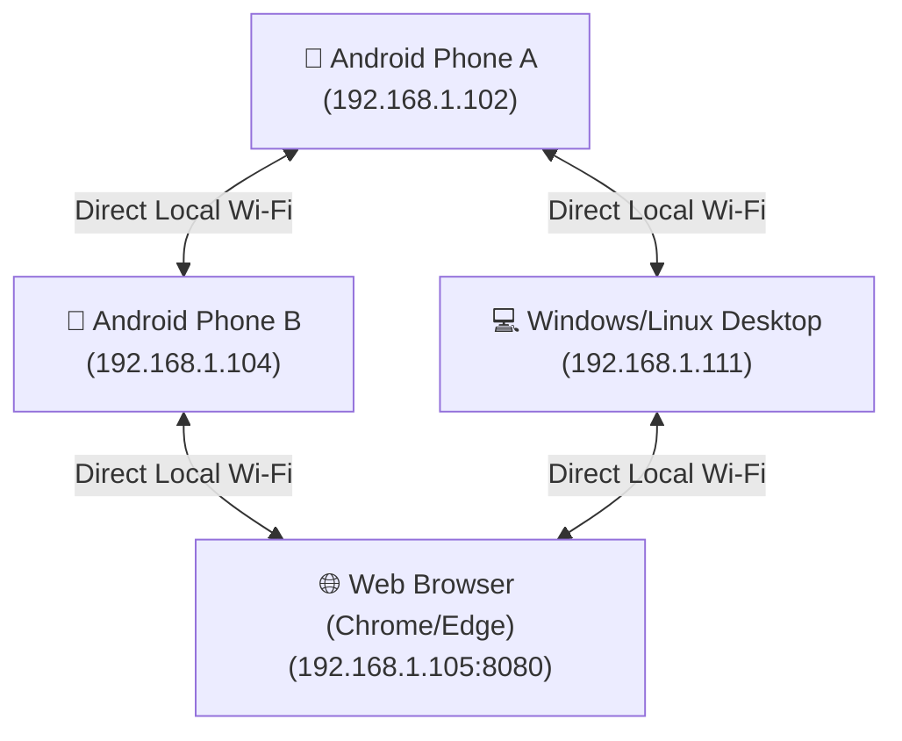
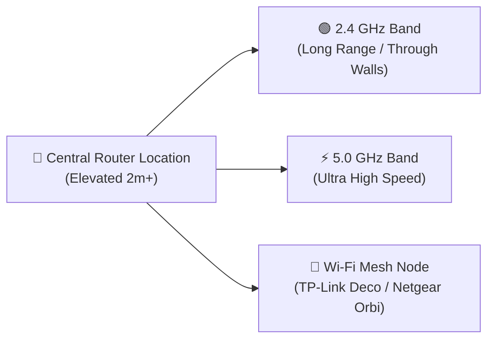

# 📶 WiFili Messenger (LanChat)


**WiFili Messenger** is a 100% offline, cross-platform, peer-to-peer messaging, file sharing, and real-time audio/video calling application that connects **Android phones, Windows PCs, Linux desktops, and Web Browsers** directly over local Wi-Fi or Mobile Hotspots without needing an internet connection or external servers.

---

## 🌐 Offline Mesh Architecture



---

## ✨ Feature Summary

| Feature | Description |
| :--- | :--- |
| **💬 Direct Messaging & Emojis** | Real-time chat with custom emoji selection. |
| **📄 High-Speed File Transfer** | Share photos, videos, audio notes, and documents (PDF, DOCX, ZIP) with percentage progress bars (`0% - 100%`). |
| **📞 Audio Calling** | Low-latency 16kHz PCM audio calls over UDP with Loudspeaker & Earpiece toggle. |
| **🎥 Video Calling** | Upright portrait video calling with front/back camera switching and local picture-in-picture preview. |
| **💻 Desktop App (Windows & Linux)** | Native Java Swing GUI app (`:desktop` module) matching the web design. |
| **🌐 Web Browser Edition** | HTML5 Web App ([web/index.html](web/index.html)) powered by an embedded HTTP Web Server. |
| **🔧 Connection Diagnostics** | Active IP status detection, network discovery scan, and step-by-step troubleshooting guides. |

---

## 🖥️ Screenshots & User Interface

### 1. Android App

- **Top Bar**: Connected SSID & User Name.
- **Header**: One-tap Audio Call (`📞`) and Video Call (`🎥`) buttons.
- **Message Timeline**: Sent/received bubbles, time stamps (`HH:mm`), checkmarks (`✓✓`), and file progress bars.

### 2. Desktop App (Windows & Linux)
- **Dark/Indigo Theme**: Custom slate theme matching Web Edition.
- **Sidebar**: Real-time LAN user search (`🔍`) with online status badges (`🟢 Online`).
- **Call Window**: Fullscreen video stream, mute microphone, and hangup controls.

### 3. Web Edition (Chrome, Edge, Firefox, Safari)
- **Offline Web Interface**: Open `index.html` or `http://localhost:8080` in Chrome/Edge.
- **Responsive Layout**: Works on desktops, laptops, tablets, and phones.

---

## 🏗️ Technical Architecture & Network Ports

| Protocol | Port | Purpose |
| :--- | :--- | :--- |
| **UDP Broadcast** | `45454` | LAN Subnet Peer Discovery (`LANCHAT\|id\|name`) |
| **TCP Sockets** | `45455` | Text Messages & File Transfer Streams |
| **UDP Stream** | `45457` | Non-blocking 16kHz PCM Audio Calling |
| **UDP Stream** | `45458` | YUV JPEG Video Frame Calling |
| **HTTP Server** | `8080` | Embedded Web Server for Chrome/Edge access |

---

## 📶 How to Increase Wi-Fi Range with a Good Router

To get maximum range and coverage for WiFili Messenger across large homes, offices, or outdoor areas, follow these recommendations:



### 1. Optimal Router Placement
- **Elevate the Router**: Place your Wi-Fi router in a central, elevated position (at least 1.5–2 meters above the floor).
- **Avoid Obstacles**: Keep the router away from thick concrete walls, metal cabinets, mirrors, and electronic appliances (microwaves, cordless phones).

### 2. Choose the Right Wi-Fi Band
- **2.4 GHz Band**: Use 2.4 GHz for **long-range coverage** through multiple walls and across larger distances.
- **5 GHz Band**: Use 5 GHz for **ultra-fast video calling and large file transfers** when devices are in the same room or close by.

### 3. Wi-Fi Range Extenders & Mesh Routers
- **Wi-Fi Mesh Systems**: Use Mesh Wi-Fi routers (e.g., TP-Link Deco, Netgear Orbi, ASUS AiMesh) to create a seamless, high-speed Wi-Fi coverage zone across multiple floors.
- **Mobile Hotspot**: When outdoors or without a router, turn on **Mobile Hotspot** on one phone. Other phones and laptops connect to it for instant 100% offline coverage!

---

## 🚀 How to Build & Run

### 1. Android App
Build and install via Android Studio or Terminal:
```bash
./gradlew :app:assembleDebug
```

### 2. Desktop App (Windows & Linux)
- **Windows**: Double-click `run-desktop.bat` or run:
  ```cmd
  run-desktop.bat
  ```
- **Linux**:
  ```bash
  chmod +x run-desktop.sh
  ./run-desktop.sh
  ```

### 3. Web App Edition (Chrome / Edge / Firefox)
- **Windows**: Double-click `run-web.bat` or run:
  ```cmd
  run-web.bat
  ```
- **Linux**:
  ```bash
  chmod +x run-web.sh
  ./run-web.sh
  ```
Open `http://localhost:8080` or `http://<your-ip>:8080` in Chrome/Edge!

---

## 📤 How to Upload & Push to Your GitHub Account

### Step 1: Link Your GitHub Repository
1. Create a new repository on [GitHub](https://github.com/new) named `WiFili-Messenger`.
2. Open terminal in the project directory and run:

```bash
# 1. Rename branch to main
git branch -M main

# 2. Add your GitHub repository remote URL
git remote add origin https://github.com/YOUR_USERNAME/WiFili-Messenger.git

# 3. Push code to GitHub
git push -u origin main
```

---

## 🔄 How to Push Future Updates to GitHub

Whenever you make future updates to the project, run these 3 simple commands in your terminal:

```bash
# 1. Stage all changes
git add .

# 2. Commit changes
git commit -m "Updated features and UI enhancements"

# 3. Push updates to GitHub
git push
```

---

## 📄 License
This project is released under the **MIT License**.
